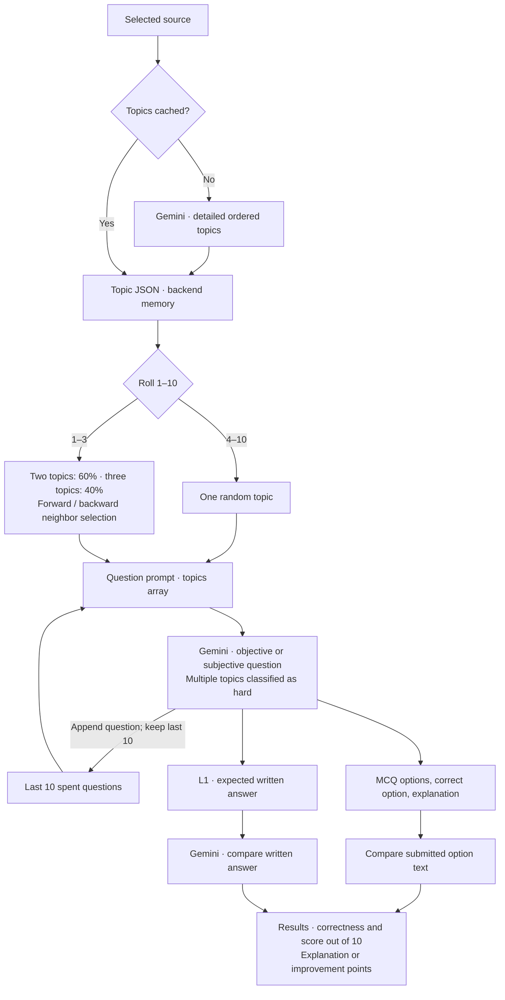

# Hereshko

Hereshko is a local study and research workspace. Organize documents, websites, and YouTube videos into notebooks, then ask questions with answers grounded in retrieved sources and numbered citations.

**Current scope: V1.** The application uses conventional RAG with hybrid retrieval, reranking, and diversity selection. **V1.5 is planned to introduce a custom GraphRAG system, with the current RAG pipeline retained as a fallback.** GraphRAG is not implemented yet.

## What V1 includes

### Notebook workspace

- Create, browse, search, sort, and rename notebooks from the notebook library.
- Open a notebook with its own indexed sources and chat workspace.
- Upload files through the picker or drag and drop.
- Add YouTube videos, scrape a single web page, or crawl a website.
- Inspect source previews and the retrieved text behind citation buttons.
- Remove one source or all sources from a notebook; removal deletes its indexed chunks and stored source records.
- Generate and refresh an introductory notebook overview from stored source previews.
- Use a monochrome interface with animated notebook navigation, loading indicators, answer reveals, and layouts for different screen sizes.

### Two chat modes

| Mode | Behavior |
| --- | --- |
| **L1** | Retrieves relevant notebook chunks and generates one cited answer. |
| **L2** | Plans focused subquestions, retrieves and answers each in sequence, then synthesizes a final answer while preserving citation numbers. |

L2 sends progress events to the frontend, which displays the planned questions, their status, intermediate answers, and the final response. The planner is instructed to generate 1–6 questions depending on the request.

Both modes support recent conversation context and an explicit **Web Search** toggle. With Web Search off, retrieval uses notebook sources. With it on, an MCP research agent searches the web and scrapes selected pages, adding the resulting evidence to the answer context. MCP failures in this mode are surfaced rather than silently dropping web research.

### Citations and formatted answers

- Answers are prompted to cite factual claims with markers such as `[1]` and `[1][3]`.
- Citation records include the retrieved text, source name and type, and available page, paragraph, slide, timestamp, or URL information.
- Citation buttons open a preview of the supporting chunk.
- Markdown is rendered through Marked and sanitized through DOMPurify; KaTeX renders supported math expressions.
- Markdown tables and sanitized HTML tables display with clear headers, row shading, borders, and horizontal scrolling. Table scroll regions are keyboard focusable.
- Formatted answers, including tables, render during the reveal animation. Answer prompts request Markdown tables rather than ASCII grids or tables inside code fences.

Table support here is **answer rendering**. The ingestion pipeline does not yet extract and preserve native document tables as structured rows and cells.

### GraphWeaver mind maps

GraphWeaver uses Gemini to turn a selected notebook source into a mind map of its central topic, main themes, and subtopics. It reads the complete persisted extraction and requests structured output matching the Pydantic `MindMap` schema.

- Open **Graphweaver** in the notebook workspace, choose a source, and click **Generate map**.
- Explore a top-down map with main themes in a row and subtopics stacked in compact columns below them.
- Expand or collapse branches using the buttons at the outgoing connectors. White connector lines stop at the final note in each branch.
- Select a node to read its summary and create a question for **Ask Hereshko**.
- Scroll or click and drag the background or a node to pan. Use **Ctrl/Command + scrollwheel** or the zoom buttons to zoom; **Fit** restores an overview.
- The map follows the monochrome theme, with progressively lighter node backgrounds at deeper levels, centered labels, and boxes that grow to fit longer text.
- Generation shows three animated dots; node reveals, branch movement, and zoom animate while respecting reduced-motion preferences.
- **Regenerate** requests a fresh map. Maps are cached by source in the open page and cleared when the page reloads.

Map generation currently uses one source at a time. Sources added before extraction persistence was introduced must be uploaded or added again before generating a map.

## TestWeaver practice

TestWeaver supports objective MCQ tests and subjective written tests. Gemini extracts detailed topics from the selected source, including summaries and key points, and is prompted to place related topics next to one another. Topic JSON is cached in backend memory by source and model and reused across tests. Expected subjective answers use the notebook's existing L1 retrieval pipeline, with numbered citation markers removed before returning them.

Each question uses the following selection process:

- A roll from 1 to 10 selects multiple topics on 1–3; otherwise it selects one random topic.
- For multiple-topic selection, another roll chooses two topics 60% of the time and three topics 40% of the time, limited by the number available.
- Selection starts at a random topic. Forward and backward pointers choose neighboring topics with a 50/50 direction roll. Pointers stay within the array, and selection switches direction when one side is exhausted, without repeating a topic.
- Both question generators receive a JSON array of the selected topics. Questions using multiple topics are prompted and classified as hard. Single-topic questions are classified by reasoning: easy for basic recall or explanation, medium for relationships or comparisons, and hard for synthesis or multiple reasoning steps.
- Question scope and answer or explanation depth are prompted to match the supplied content and cover each selected topic meaningfully.

A shared `spent_questions` list holds the 10 most recent successfully generated question texts across both modes and all sources. Each question prompt includes this list and asks Gemini to avoid identical or similar questions. This reduces repetition but does not guarantee uniqueness. Topic ordering by similarity is also a prompt instruction, rather than a validated grouping.

| Method | Endpoint | Purpose |
| --- | --- | --- |
| `POST` | `/testweaver/objective/generate` | Generate MCQs from a source |
| `POST` | `/testweaver/subjective/generate` | Generate written questions and expected answers |
| `POST` | `/testweaver/objective/submit` | Check selected option strings |
| `POST` | `/testweaver/subjective/submit` | Evaluate written answers |

Open **Testweaver** in Studio, select a source, choose objective or subjective questions, and generate a test. Difficulty badges use green for easy, yellow for medium, and red for hard. Answer every question, then click **Check answers** to see scores out of 10, explanations, and improvement points. Expected subjective answers can be expanded after checking.

Generation uses query parameters `document_id`, `notebook_id`, and `number_of_questions`. Objective tests accept 1–10 MCQs; subjective tests accept 1–3 questions. Objective questions include four options, the exact `correct_option` string, and an explanation. Subjective generation returns `[question, expected_answer]` pairs. All answers are available to the frontend, which controls when feedback is displayed.

Objective submission sends JSON `question_list` and `provided_answers_list`; subjective submission sends `pairs_list` and `answer_list`. Both return result lists containing correctness, a score out of 10, and optional improvement points or an MCQ explanation. The UI shows the mean question score. Failed checks preserve answers for retrying.

Tests stay in the open page's memory and survive closing and reopening the panel. Reloading the page clears them. Testweaver does not persist tests. Backend topic caches and the spent-question list reset when the backend restarts. The interface matches the site's serif headings and monochrome styling, with difficulty colors, subtle button press animations, three loading dots, staggered question slides, and animated feedback while respecting reduced-motion preferences. Generation displays “Generating your test. This may take a while.” Results requiring improvement display “Needs improvement.”

## Supported sources

| Source | Current extraction path | Position metadata |
| --- | --- | --- |
| `.txt` | UTF-8 text | No page or paragraph positions |
| `.pdf` | Page text extracted with pdfplumber | Page number |
| `.docx` | Paragraph text extracted with python-docx | Paragraph index |
| `.pptx` | LibreOffice renders slides to PDF; PaddleOCR recognizes the rendered text | Slide number |
| Website: scrape | Fetch one page and extract its main text with Trafilatura | Source URL |
| Website: crawl | Follow links within the starting domain, collecting up to 12 content-bearing pages | Source URL per page |
| YouTube | Download audio with yt-dlp, process it with FFmpeg, and transcribe with Groq Whisper | Segment start timestamp and source URL |

Website fetching starts with HTTP requests. A Playwright Chromium fallback is used when the returned page has no visible text after removing non-content tags; it is not a universal fallback for every JavaScript-heavy site or failed request.

YouTube audio is split into 30-minute segments for transcription. Segment timestamps are offset back to their position in the full video. Temporary upload, rendering, and audio files are cleaned up after processing.

## Architecture

```mermaid
flowchart TB
    frontend["Frontend · HTML / CSS / JavaScript"] --> api["FastAPI"]

    subgraph ingestion["Source ingestion"]
        extract["Extract and normalize"] --> chunk["Chunk text"]
        chunk --> embed["Embed chunks · BGE"]
    end

    subgraph storage["Storage"]
        documents[("Persisted document JSON")]
        vectors[("Weaviate · chunks and embeddings")]
        metadata[("SQLite · notebooks and source metadata")]
    end

    subgraph chat["L1 / L2 chat"]
        query["Embed query"] --> retrieve["Hybrid retrieval"]
        retrieve --> rank["Reranker and MMR"]
        rank --> answer["Groq · cited answers"]
        research["Optional MCP web research\nDuckDuckGo and page scraping"] --> answer
    end

    subgraph studio["Studio"]
        graph["GraphWeaver · Gemini mind maps"]
        tests["TestWeaver · Gemini topics and questions"]
    end

    api --> extract
    api --> query
    api -. "Web Search enabled" .-> research
    api --> graph
    api --> tests
    api <--> metadata
    extract --> documents
    embed --> vectors
    embed --> metadata
    vectors --> retrieve
    documents --> graph
    documents --> tests
    tests -. "Subjective expected answers use L1" .-> query
    answer --> frontend
    graph --> frontend
    tests --> frontend
```

### TestWeaver generation and checking



### Current retrieval defaults

| Component | Configuration in the code |
| --- | --- |
| Chunking | Recursive splitting within extraction boundaries; 384 tokens with 48-token overlap |
| Token counting | `Qwen/Qwen3.8-27B` tokenizer |
| Embeddings | `BAAI/bge-large-en-v1.5`, normalized vectors, batch size 8 |
| Query embeddings | BGE retrieval instruction prepended to the query |
| Vector store | Local Weaviate `Chunks` collection with application-provided vectors |
| Hybrid search | Keyword and vector search with `alpha=0.6`, filtered by notebook ID |
| Reranker | `cross-encoder-ms-marco-MiniLM-L-6-v2` in a separate Docker service |
| Diversity selection | Maximum marginal relevance (MMR), `lambda=0.75` |
| L1 context | Up to 10 chunks from 20 candidates, or 24 candidates when the notebook has more than 5 sources |
| L2 subanswer context | Up to 10 chunks from 20 candidates per subquestion |
| Answer model | Groq model configured by `GROQ_LLM_MODEL`; current default is `qwen/qwen3.8-27b` |
| Transcription model | `whisper-large-v3-turbo` through Groq |

Extraction boundaries preserve source positions while chunking. Embedding inputs include the source title, source type, and chunk text. Source records are saved after their chunks have been inserted into Weaviate.

Before chunking and indexing, each extracted `Document` is saved as JSON under `data/persist/<document_id>/document.json`. GraphWeaver loads this file, sends its content to Gemini, and returns a flat list of nodes with IDs, parent IDs, titles, and summaries. The frontend assembles the tree from those parent links; the root has `parent_id: null`.

### Storage and session lifetime

- **SQLite:** `data/hereshko.db` stores notebook records, source metadata, and the first 2,000 characters of each source as a preview.
- **Weaviate:** the Docker volume `weaviate_data` stores chunk text, embeddings, and citation position metadata.
- **Conversation history:** held in backend memory, with up to eight messages per session. It is lost when the backend restarts; the frontend creates a new session when the page loads.
- **Notebook overview cache:** held in backend memory for L2 planning and invalidated when sources change.
- **Persisted extractions:** `data/persist/<document_id>/document.json` keeps complete extracted text and metadata for GraphWeaver, even if later indexing fails. These files are ignored by Git; source deletion currently leaves them on disk.
- **Mind maps:** cached in frontend memory for the open page; generated maps are not saved to the backend.
- **TestWeaver:** tests and answers are held in frontend memory. Topic JSON is cached in backend memory by source and model; a shared list keeps the last 10 generated questions for repetition avoidance. Neither is persisted.
- **Original uploads:** temporary uploaded files are still removed after processing. The persisted JSON contains extracted content, not the original PDF, DOCX, or PPTX.

## Local setup

The bundled launcher targets Windows and PowerShell. Python dependencies are defined in `pyproject.toml` and locked in `uv.lock`; `requirements.txt` is currently empty.

### Prerequisites

- Python 3.11 for the project environment and `uv` for dependency management.
- Docker Desktop with Docker Compose.
- A Groq API key for chat, notebook overviews, and YouTube transcription.
- A Gemini API key for GraphWeaver mind maps and TestWeaver topic generation, question generation, and subjective grading.
- An NVIDIA GPU with working Docker GPU support for the bundled reranker configuration. Compose requests all GPUs and enables CUDA for that service.
- LibreOffice for PPTX ingestion.
- FFmpeg and Deno for the YouTube ingestion path, available on `PATH` or through the supported Deno configuration.
- Playwright Chromium for the website rendering fallback.
- Internet access for initial model downloads, remote model calls, website research, and YouTube processing. The frontend also loads formatting libraries from a CDN.

Embeddings default to CUDA and fall back to CPU when PyTorch reports CUDA unavailable. PaddleOCR chooses GPU when available and otherwise CPU. These application fallbacks do not change the GPU requirements of the supplied reranker container.

### Configure the environment

Create or edit `.env` in the repository root. A minimal configuration is:

```dotenv
GROQ_API_KEY=your_groq_api_key
GEMINI_API_KEY=your_gemini_api_key
```

Useful optional settings and their current defaults:

```dotenv
GROQ_LLM_MODEL=qwen/qwen3.8-27b
GROQ_WHISPER_MODEL=whisper-large-v3-turbo
GEMINI_MODEL=gemini-3.5-flash-lite
EMBEDDING_MODEL=BAAI/bge-large-en-v1.5
EMBEDDING_DEVICE=cuda
EMBEDDING_BATCH_SIZE=8
MCP_SERVER_URL=http://127.0.0.1:8765/mcp
WEB_TOOL_MAX_ITERATIONS=2
YT_JS_RUNTIME=deno
```

Restart the backend after changing settings. The current Weaviate client uses `connect_to_local()`; changing `WEAVIATE_URL` alone does not redirect that connection.

### Install dependencies

From the repository root:

```powershell
uv sync --locked
uv run playwright install chromium
```

The Windows dependency configuration uses CUDA builds of PyTorch and PaddlePaddle, with associated NVIDIA runtime packages. The first setup and first ingestion can take longer while dependencies and models download.

### Start the application

Open Docker Desktop and wait until it is running, then execute:

```powershell
.\start.ps1
```

The launcher syncs dependencies, adds installed CUDA runtime directories to the process environment, starts the Compose services, launches the MCP server, API, and frontend in separate PowerShell windows, and opens the app. Its frontend command uses the Windows `py` launcher.

| Service | Address |
| --- | --- |
| Frontend / notebook library | http://localhost:4173 |
| FastAPI | http://localhost:8000 |
| Interactive API documentation | http://localhost:8000/docs |
| MCP web tools | http://127.0.0.1:8765/mcp |
| Weaviate HTTP | http://localhost:8080 |
| Weaviate gRPC | localhost:50051 |

For manual startup, run Compose from the root and keep each long-running command in a separate terminal:

```powershell
docker compose up -d
uv run python -m app.mcp_server
uv run uvicorn app.main:app --reload --port 8000
uv run python -m http.server 4173 --directory frontend
```

On Windows, prefer `start.ps1` when using PaddleOCR so the launcher prepares the installed CUDA runtime paths. The API entry point is `app.main:app`; the root `main.py` is a placeholder.

To stop manually launched servers, press Ctrl+C in their terminals. To stop the launcher processes, close their server windows. Stop the containers with `docker compose down`, which retains the named data volume.

## Using Hereshko

1. Open the frontend and create or select a notebook.
2. Add sources through file upload, a YouTube URL, or the website scrape/crawl controls.
3. Wait for indexing to complete and check the source cards for errors.
4. Read or refresh the introductory overview.
5. Ask a question in L1, or switch to L2 for a question that benefits from decomposition.
6. Enable Web Search when you want additional evidence from the web.
7. Open the numbered citation buttons to inspect the supporting text.
8. Open **Graphweaver**, select a source, and generate a mind map. Expand its branches, inspect concept summaries, or send a selected concept's prompt to chat.

The notebook library supports search, sorting, creation, and renaming. The workspace title is also editable. Source deletion updates both the notebook metadata and the vector index.

## YouTube authentication

Public videos are attempted without browser cookies. Keep `YT_PLAYER_CLIENT` empty to use yt-dlp defaults. The dependency includes the JavaScript solver through `yt-dlp[default]`, and the runtime defaults to Deno. Set `YT_DENO_PATH` if the executable is not found automatically.

Configured cookies are tried only after a download error indicates authentication is required. For a signed-in Opera GX session on Windows:

```dotenv
YT_COOKIES_BROWSER=opera-gx
```

The project maps Opera GX to its standard Windows profile location. Other supported browser sources include Chrome, Edge, Firefox, Brave, Chromium, Opera, Vivaldi, Whale, and Safari on macOS, subject to yt-dlp and platform support.

| Setting | Purpose |
| --- | --- |
| `YT_COOKIES_BROWSER` | Browser used for the authentication retry |
| `YT_COOKIES_PROFILE` | Specific profile name or path |
| `YT_COOKIES_FILE` | Exported Netscape-format cookie file; takes precedence over browser extraction |
| `YT_COOKIES_KEYRING` | Optional Linux Chromium keyring |
| `YT_COOKIES_CONTAINER` | Optional Firefox container |
| `YT_PLAYER_CLIENT` | Optional comma-separated client override for unauthenticated attempts |
| `YT_JS_RUNTIME` / `YT_DENO_PATH` | JavaScript runtime and optional Deno executable path |

Cookies must be available on the machine running the backend. A locked browser database or OS encryption can prevent extraction; closing the browser or using an exported cookie file may help. Keep API keys and cookie files outside version control. Empty cookie settings leave ingestion unauthenticated.

## API reference

| Method | Endpoint | Purpose |
| --- | --- | --- |
| `GET` | `/notebooks` | List notebooks |
| `POST` | `/notebooks` | Create a notebook with a JSON `title` |
| `GET` | `/notebooks/{notebook_id}` | Read notebook details |
| `PATCH` | `/notebooks/{notebook_id}` | Rename a notebook with a JSON `title` |
| `GET` | `/notebooks/{notebook_id}/sources` | List indexed source records and metadata |
| `DELETE` | `/notebooks/{notebook_id}/sources/{document_id}` | Remove one source |
| `DELETE` | `/notebooks/{notebook_id}/sources` | Remove all sources in a notebook |
| `POST` | `/notebooks/{notebook_id}/summary` | Generate an introductory overview |
| `POST` | `/notebooks/{notebook_id}/mindmap` | Generate a map from a notebook source using a JSON `document_id` |
| `POST` | `/ingest/upload` | Upload a file with multipart `file` and `notebook_id` |
| `POST` | `/ingest/scrape` | Index one page with form `url` and `notebook_id` |
| `POST` | `/ingest/website` | Crawl and index a site with form `url` and `notebook_id` |
| `POST` | `/ingest/youtube` | Transcribe and index a video with form `url` and `notebook_id` |
| `POST` | `/chat/l1` | Return a JSON answer and citations |
| `POST` | `/chat/l2` | Stream research progress and the final answer as NDJSON |

Example mind-map request body:

```json
{
  "document_id": "your-document-id"
}
```

The document must belong to the notebook in the URL. The response is `{"nodes": [...]}`, with each node containing `id`, `parent_id`, `title`, and `summary`. Missing persisted content returns HTTP 409; Gemini quota limits return 429, temporary unavailability returns 503, and timeouts return 504. Other generation errors include a readable `detail` message for the frontend.

Example L1 request:

```json
{
  "notebook_id": "your-notebook-id",
  "query": "Compare the approaches described in my sources.",
  "session_id": "optional-session-id",
  "web_search": false,
  "mode": "l1"
}
```

Use `/chat/l2` for L2; the endpoint determines execution mode. Its newline-delimited events include `planning`, `planned`, `answering`, `answered`, `synthesizing`, `done`, and `error`. The `done` event contains `answer` and `sources`. Progress streaming is separate from token streaming: completed model responses are revealed with a frontend animation.

The MCP service exposes `web_search` through DuckDuckGo and `scrape_page` through the shared website scraper. Its search results and page text become temporary evidence chunks for the current answer, rather than automatically saved notebook sources.

## Project layout

```text
app/
  api/                 Chat, ingestion, notebook, and GraphWeaver routes
  clients/             Groq, Weaviate, and MCP connections
  core/                Documents, chunks, notebooks, conversations, errors
  schemas/             API request and response models
  services/
    ingestion/         Source extractors and indexing
    rag/               Chunking, embeddings, retrieval, L1/L2, citations
    scraper/           HTTP/browser fetching, extraction, crawling
    search/            DuckDuckGo search
    video/             YouTube audio download and transcription
    graphweaver/       Gemini mind-map generation from persisted sources
  storage/             SQLite metadata, extracted document JSON, overview cache
  main.py              FastAPI entry point
  mcp_server.py        MCP web tools entry point
frontend/              Static notebook library and workspace
data/                  Local SQLite database and persisted extractions
tests/                 Regression tests, smoke scripts, retrieval benchmarks
docker-compose.yml     Weaviate and GPU reranker services
pyproject.toml         Python dependencies and uv index configuration
uv.lock                Dependency lockfile
start.ps1              Windows development launcher
```

## Development and checks

Run commands from the repository root. Targeted Python regression checks include:

```powershell
uv run python -m unittest tests.test_citations tests.test_l1 tests.test_l2_planner tests.test_l2_citation_start tests.test_web_search_modes
uv run python -m unittest tests.test_notebook_routes tests.test_notebook_summary tests.test_summary_generation tests.test_youtube_downloader
uv run python -m unittest tests.test_chunker
```

These tests use mocks and temporary databases where implemented, but imports still require the project dependencies and model configuration. The chunker test sets Hugging Face offline mode and requires the Qwen tokenizer to be cached already.

Frontend regression checks use Node.js and its built-in test utilities, with no frontend package installation:

```powershell
node tests/test_notebook_frontend.cjs
node tests/test_notebook_streaming.cjs
node tests/test_l2_frontend.cjs
node tests/test_ingestion_loading.cjs
```

GraphWeaver browser checks use Playwright Chromium and fixture API responses, without calling Gemini or changing notebook data:

```powershell
uv run python -m tests.test_graphweaver_frontend
```

They cover generation requests, loading-dot visibility, compact layout, nested connectors, label sizing and centering, depth shading, branch controls, scrolling, zoom, dragging, retries, cached maps, mobile layout, and reduced motion. The check also writes preview screenshots to a temporary directory.

The repository also contains scraper checks, live ingestion smoke scripts, and read-only retrieval benchmarks. Live smoke scripts can create indexed sample data and require running services. The benchmark modules use existing indexed sources and local models; they measure dense retrieval and MMR rather than the full hybrid/reranker/answer pipeline.

```powershell
uv run python -m tests.benchmark_chunking
uv run python -m tests.benchmark_retrieval_counts
```

An older dispatcher assertion in `tests/test_l2_routes.py` refers to `routes_chat.chat`, which is absent from the current explicit L1/L2 route implementation. That test needs updating before treating full-suite discovery as a release check.

## Current limits

- PDF ingestion requires extractable text; scanned or image-only PDFs do not have an OCR fallback.
- DOCX ingestion currently reads paragraphs, without structured native table extraction. PPTX OCR extracts text without preserving table cells or slide layout.
- Notebook overviews use only the first 2,000 characters of each source. They are introductory context, not exhaustive summaries.
- Conversation history and overview caches are not persisted across backend restarts.
- L1 returns a complete JSON response; L2 streams progress events, not individual generated tokens.
- Citation instructions guide model output; they are not an independent factual verification system.
- GraphWeaver generates a single-source hierarchy rather than a cross-source entity graph. Node summaries do not include individual evidence citations, and sending a prompt to chat uses the existing notebook chat retrieval.
- GraphWeaver sends the complete extracted source in one Gemini request; very large documents must fit the configured model's input limit. Maps are not persisted across page reloads.
- Noteweaver and authentication scaffolding do not currently expose implemented application features. The app is a local development workspace without account access controls.
- The provided Compose deployment enables anonymous Weaviate access and is intended for local development.

## Troubleshooting

| Symptom | Check |
| --- | --- |
| Launcher stops at the Docker check | Start Docker Desktop and wait for `docker info` to succeed. |
| Retrieval or indexing cannot connect | Check `docker compose ps` and the Weaviate/reranker logs; confirm HTTP port 8080 and gRPC port 50051 are available. |
| GPU reranker fails to start | Check Docker GPU support and the NVIDIA driver. A CPU container configuration requires changing Compose explicitly. |
| Chat or overview generation fails | Check `GROQ_API_KEY`, configured model access, and the backend error output. |
| GraphWeaver reports no saved extracted content | Upload the file or add the website/video again, then select the new source. Older indexed sources do not have persisted extraction files. |
| GraphWeaver generation fails | Check `GEMINI_API_KEY` and `GEMINI_MODEL`. For 429, check quota; for 503 or 504, retry later. Restart the backend after configuration changes. |
| GraphWeaver still shows an older layout | Hard-refresh the frontend with Ctrl + Shift + R, then reopen the map. |
| Web Search fails | Confirm `app.mcp_server` is running and `MCP_SERVER_URL` points to its `/mcp` endpoint. |
| PPTX ingestion fails | Check LibreOffice discovery, PaddleOCR dependencies, and CUDA runtime paths; use the Windows launcher. |
| YouTube processing fails | Check FFmpeg, Deno, Groq transcription access, and any reported authentication/cookie failure. |
| Website rendering fallback fails | Install Playwright Chromium and check whether the page can be fetched without authentication. |
| First ingestion is slow or offline imports fail | Allow the embedding model and tokenizer to download once before using offline mode. |
| Tables or math appear unformatted | Check that the CDN formatting scripts loaded, then reload the page. |

The frontend defaults to `http://localhost:8000`. To override it, set `window.HERESHKO_API_URL` before loading `app.js` or `notebooks.js` on the relevant page. The backend currently allows frontend origins on localhost/127.0.0.1 ports 4173 and 5173; other origins require a CORS configuration change.

## Roadmap

**V1 — current baseline:** notebook management, source ingestion and extraction persistence, conventional RAG, L1/L2 research, optional MCP web evidence, citations, introductory overviews, formatted answers, and GraphWeaver mind maps.

**V1.5 — planned:** engineer a custom GraphRAG retrieval path that connects entities and relationships across notebook sources, preserves links to original evidence, and keeps the existing RAG system as a fallback. Evaluate it against real notebook questions before making it the primary path.

GraphWeaver currently generates source-derived mind maps directly from persisted documents. Cross-source entity and relationship exploration remains planned as part of the GraphRAG foundation.
